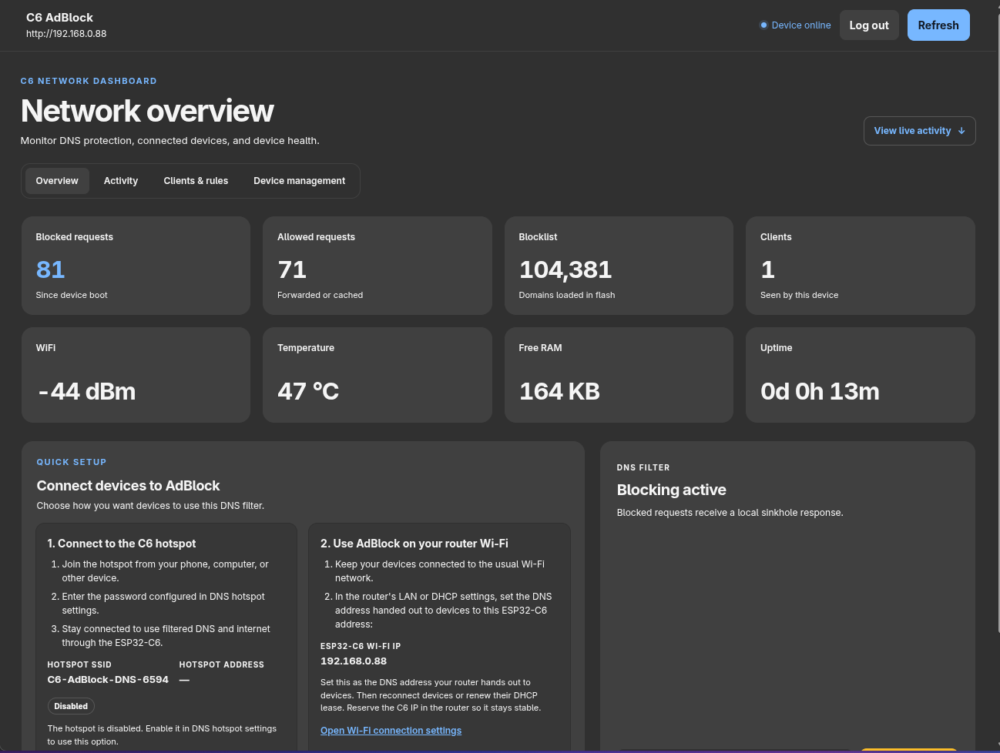

# ESP32-C6-AdBlock

A **Pi-hole-style DNS ad-blocker** for ESP32-C6-WROOM boards — *no PSRAM required*.



> **Origin:** Adapted for ESP32-C6 from [M-Abozaid's DNS ad-blocker for ESP32-C3](https://github.com/M-Abozaid/esp32-c3-adblock). This README covers the ESP32-C6 adaptation only.

The trick everyone misses: you don't need to keep the blocklist in RAM. Store the
domains as **sorted 40-bit hashes in flash** and keep a 14-bit prefix directory in
RAM. A lookup reads the matching contiguous bucket from flash; unusually dense
buckets use a bounded binary-search fallback. 140,000+ domains fit in ~0.7 MB of
flash, and the index supports up to about 2.08 million hashes.

```
query in ──▶ extract domain ──▶ FNV-1a hash (+ parent suffixes)
         ──▶ select a 14-bit prefix bucket, read that range from flash
              ├─ hit  ──▶ answer 0.0.0.0   (sinkholed)
              └─ miss ──▶ forward to upstream resolver, relay the reply
```

Upstream forwarding is non-blocking (up to 32 requests in flight). Successful
answers are cached for their DNS TTL, capped at five minutes; blocklist checks
still run before cache lookups.

## Why this is interesting

The ESP32-C6 can store fixed **5-byte (40-bit) hashes in flash**, so the blocklist
does not need to be loaded into RAM:

| Metric | ESP32-C6 |
|---|---|
| Hardware | ESP32-C6-WROOM, no PSRAM |
| 141k domains | **0.67 MB of flash** |
| RAM used | fixed buffers, independent of blocklist size |
| Lookup | one contiguous bucket read in the common case |
| Expected collision pairs* | ~0.009 at 141k; ~0.13 at 537k |

**Why 40 bits?** Under a uniform-hash assumption, the birthday-bound estimate is
about 0.009 colliding pairs at 141k domains and 0.13 at 537k (roughly a 12% chance
of at least one collision at 537k). Actual collisions depend on the source list;
any collision can over-block a domain. Dropping to 32 bits would save 20% of the
flash but produce about 7 expected collision pairs at 250k. Going to 64 bits costs
3 more bytes per domain to reduce an already-low risk.

\* Expected colliding pairs assume uniformly distributed 40-bit hashes.

The firmware builds a 16,384-bucket prefix directory (about 64 KiB of RAM) by
scanning the sorted blocklist sequentially at boot and after updates. It can
address up to **~2.08M domains** without loading the full blocklist into RAM.

## Hardware

- The current dual-OTA layouts support ESP32-C6 boards with **8 MB or 16 MB flash**. Use the `c6` environment for 16 MB and `c6_8mb` for 8 MB; check your module's actual flash size before flashing.
- The standard ESP32-C6-DevKitC-1 has 8 MB flash, so use `c6_8mb`. Current layouts do not support 4 MB variants without a smaller custom partition layout.
- No PSRAM is required. The BOOT button on the ESP32-C6-DevKitC-1 uses GPIO9.
- Its onboard addressable RGB LED is driven by GPIO8 and indicates device status:

  | State | LED pattern |
  |---|---|
  | AP setup portal (`C6-AdBlock-XXXX`) | Slow blink, yellow |
  | Wi-Fi connected and DNS sockets ready | Steady green |
  | Wi-Fi offline outside setup | Very slow blink, teal |
  | Critical service or storage failure | Fast blink, red |
  | Remote blocklist download | Medium blink, blue |
  | Remote download attempted without internet | Flashing purple |

  The regular DNS hotspot (`C6-AdBlock-DNS-XXXX`) remains green while the router
  Wi-Fi and DNS service are working. A failed network download flashes purple
  for four seconds after the attempt returns.
- Power it from a **stable USB source** (a phone charger or your router's USB port).
  Cheap/loose USB-C→A adapters can brown out the radio during WiFi transmit.
- Keep the module antenna clear of metal and enclosure walls to preserve WiFi signal.

## First-time setup

1. **Choose the build for your flash size.** Use `c6` for 16 MB or `c6_8mb` for
   8 MB. The standard ESP32-C6-DevKitC-1 uses the 8 MB build. The current
   partition layouts do not support 4 MB modules.
2. **Set the dashboard credentials before flashing.** Copy
   `src/secrets.example.h` to `src/secrets.h`, then set `WEB_USER` and `WEB_PASS`
   to private values. Set `C6_AP_PASSWORD` to a private password of at least 8
   characters for the DNS hotspot. You can leave `WIFI_SSID` and `WIFI_PASS` as
   placeholders if you plan to use the setup portal.
3. **Build a blocklist and flash both firmware and filesystem.** Follow the
   commands in [Build & flash](#build--flash-platformio), using the environment
   selected in step 1. `upload` flashes the firmware; `uploadfs` installs the
   generated blocklist. This initial setup needs a USB connection.
4. **Connect the device to WiFi.** Open the serial monitor. If the device has no
   working router credentials, join the open `C6-AdBlock-XXXX` setup network from
   a phone or computer. Use its captive page to select your router and enter its
   password. The device saves the credentials and restarts.
5. **Open the dashboard.** After the device joins the router, visit
   `http://c6adblock.local` or the station IP printed in the serial monitor. Sign
   in with `WEB_USER` and `WEB_PASS` from `secrets.h`. The DNS hotspot
   `C6-AdBlock-DNS-XXXX` starts by default; its password is `C6_AP_PASSWORD` unless
   you changed it in Device Management.
6. **Point clients at the C6.** Devices that join its DNS hotspot receive the C6
   as their DNS server automatically. For devices that stay on the router's WiFi,
   set the C6 station IP as DNS in the router's DHCP settings. Some clients may
   bypass filtering if another DNS server is configured as a secondary resolver.
7. **Check DNS from a client on the network:**

   ```bash
   dig @<c6-ip> doubleclick.net
   dig @<c6-ip> github.com
   ```

   The first query should return `0.0.0.0`; the second should be forwarded to the
   upstream resolver.

## Build & flash (PlatformIO)

One USB flash to get going — after that, **firmware and blocklist both update over WiFi** (see below).

> Use a current PlatformIO release. The C6 target uses the pioarduino platform for
> Arduino core 3.x support. A 16 MB ESP Web Tools installer bundle is included in
> `docs/`; this repository does not currently publish it as a hosted installer.

```bash
# 1. Keep your existing src/secrets.h. If it does not exist yet, create it from
#    the template and set WEB_USER / WEB_PASS before flashing.
#    Dashboard credentials can also be changed later under Device Management.
#    WIFI_SSID / WIFI_PASS can be left as placeholders if you will use the
#    on-device setup portal instead. C6_AP_PASSWORD is the initial DNS hotspot
#    password; it can also be changed later from the dashboard.
test -f src/secrets.h || cp src/secrets.example.h src/secrets.h

# 2. build the blocklist hash table (default = StevenBlack base + Hagezi Light,
#    ~100k entries, WhatsApp/social safe)
python3 tools/build_blocklist.py data/blocklist.bin

# 3. flash firmware + the blocklist filesystem (the one and only USB flash)
pio run -t upload
pio run -t uploadfs

# 4. watch it boot, note the IP / open the dashboard
pio device monitor          # -> http://c6adblock.local
```

### Flash size and partitions

The default `c6` environment targets the 16 MB ESP32-C6-WROOM, with two 2.5 MB
OTA app slots and the remaining flash for LittleFS. The `c6_8mb` environment uses
the matching 8 MB partition layout. Both retain firmware OTA.

```bash
pio run -e c6 -t upload
pio run -e c6 -t uploadfs
pio device monitor -e c6
```

Use `-e c6_8mb` in these commands for an 8 MB module.

On a custom carrier board, check that its BOOT button is wired to GPIO9 before
using it to reset saved settings from hardware.

### Your own blocklists

`build_blocklist.py OUT.bin [SOURCE ...]` takes any mix of URLs and local files, in any of
these formats:

- **hosts files** — `0.0.0.0 ads.example.com tracker.example.com` (all domains on the line are included)
- **plain domain lists** — one domain per line
- **AdGuard / Adblock basic rules** — `||ads.example.com^` blocks, `@@||ok.example.com^`
  removes a domain (e.g. to mirror an AdGuard Home allowlist)

A blocked domain also blocks its subdomains. Rules a DNS hash list can't express (regex,
wildcards, `$` modifiers, cosmetic `##` rules) are skipped and counted. An `@@` rule only
un-blocks that exact entry — it can't carve a subdomain out of a blocked parent. If a source
can't be downloaded the build stops instead of silently producing a smaller list
(`--allow-missing` to override).

### WiFi setup (no re-flash needed)

If it can't connect (or you never set `secrets.h`), it starts an open setup access
point **`C6-AdBlock-XXXX`** with a captive portal — join it from a phone, pick
your network, type the password, done. To move it to a new network later, enter
the new router SSID and password under **Device Management → Wi-Fi connection**.
To reset all saved settings from hardware, hold **BOOT** (GPIO9) while powering on; this
clears WiFi, dashboard login, hotspot, custom domains, banned clients, and update
settings while keeping firmware and the installed blocklist. You can also use
**Reset all configuration** under Device Management to clear the saved settings.
Saving new Wi-Fi credentials restarts the device; if it cannot join that network,
the setup access point opens.

After it joins the router, it also starts **`C6-AdBlock-DNS-XXXX`**. Its DHCP server
gives connected devices an address, advertises the C6 as their DNS resolver, and
routes their internet traffic through the upstream WiFi connection. The AP uses
WPA2; `C6_AP_PASSWORD` in `src/secrets.h` supplies its initial password (at least
8 characters). From **Device Management → DNS hotspot** on the dashboard, you can
change the SSID or password and enable or disable the hotspot. Saving settings
restarts the device, and the settings persist independently of the router WiFi
credentials. The SSID and AP address are printed to serial at startup. To keep
devices on the router's WiFi, set the C6's station IP as DNS in the router's DHCP
settings.

## Over-the-air updates (no more USB)

The dashboard at **http://c6adblock.local** does it all:

- **Blocklist** — drop a freshly built `blocklist.bin` into *Blocklist → Upload*, or set a
  direct URL to a compatible prebuilt file under *Remote auto-update*. The device
  accepts HTTPS URLs with certificate validation, follows only HTTPS redirects,
  and checks the source on the configured schedule (24 hours by default); no remote
  source is configured until you provide one. Build compatible files with
  [`tools/build_blocklist.py`](tools/build_blocklist.py).
- **Firmware** — upload `.pio/build/<environment>/firmware.bin` under *Firmware → OTA update*;
  use `c6` for ESP32-C6. The dashboard login protects the upload, then the device
  verifies the image and reboots. Use `-e c6_8mb` for an 8 MB module.

The dashboard shows recent blocked domains and client IPs. The device keeps a
12-event ring buffer in RAM; the browser can save up to 200 received events in
its localStorage. This log does not write to device flash.

The 16 MB layout reserves about 10.9 MiB for LittleFS; the 8 MB layout reserves
about 3 MiB. The blocklist index supports up to ~2.08M domains, subject to the
filesystem space available on the selected module.

## Security

Unauthenticated visits to `/` show only the sign-in page. Its initial credentials are
`WEB_USER` and `WEB_PASS` from `secrets.h`; you can change them after signing in
under **Device Management → Dashboard login**. Saved credentials persist in
device Preferences across reboots. Leave the new-password field blank to keep
the current password; saving signs out all dashboard sessions. A successful
sign-in creates an HttpOnly, SameSite=Strict session cookie that expires after
12 hours. After sign-in, the dashboard and its status APIs (`/stats.json`,
`/events.json`) require that session. `POST /login` is the only API endpoint
available before sign-in. Every management endpoint also requires the session:

- `/ban`, `/addblock`, `/unblock`, `/pause`, `/resume`
- `/hotspot`, `/wifi`, `/dashboard-credentials`, `/reset-config`
- `/upload`, `/update` (blocklist and firmware OTA)
- `/setupdate`, `/fetchnow`, `/logout`

**Reset all configuration** under Device Management clears saved WiFi and
dashboard credentials, hotspot settings, custom domains, banned clients, and
automatic blocklist update settings, then restarts the device. It keeps the
installed firmware and blocklist. On restart, the device uses defaults compiled
into the installed firmware from `secrets.h`. If you change `secrets.h`, build
and flash that firmware before resetting to use the new values. If no WiFi
fallback is compiled in, use the setup access point.

State-changing dashboard requests also require the custom
`X-Requested-With: c6-adblock` header. The dashboard sends it automatically, so
management actions reuse the initial sign-in without a separate browser login
prompt. Firmware updates are accepted through the dashboard session; the separate
ArduinoOTA/`espota` service is disabled.

Without these checks, anyone who could reach the device on the LAN could reflash
it with arbitrary firmware or rewrite the blocklist — worth knowing given the
device sits in the path of every DNS query on your network. Custom blocked-domain
names are also HTML-escaped before being rendered on the dashboard, closing a
stored-XSS path where a domain string containing markup (added via `/addblock`)
would otherwise execute in the viewing browser.

**Sign-in is a LAN access control, not encryption.** Everything is plain HTTP on
:80 — this chip has no realistic budget to run a TLS server. The username and
password, session cookie, and Wi-Fi or hotspot credentials submitted in the
dashboard can be read by someone who can sniff LAN traffic (for example, on an
open or guest WiFi network, or through ARP spoofing). The Strict cookie setting
and custom request header help prevent cross-site requests from driving the
dashboard, but they do not protect against an on-path network attacker.

**Default credentials:** if the dashboard is still using
`CHANGE_ME_WEB_PASSWORD` or the hotspot is still using
`CHANGE_ME_AP_PASSWORD` from `secrets.example.h`, those values are public (they're
in this repo's example file). The firmware logs a warning over serial and shows a
banner on the dashboard while a placeholder is active. Change the dashboard
credentials in Device Management or in `secrets.h` before flashing, and choose a
private hotspot password before using the device on a network you don't fully
control.

The WiFi setup portal's access point (`C6-AdBlock-XXXX`) remains open by design
so it can be joined before WiFi credentials are configured. The real WiFi
password entered there is only as safe as that local radio link during setup.

## Use it

Set the C6 as the device's DNS resolver. If you configure it as a secondary
resolver, some clients may also use the other resolver and bypass filtering. Test:

```bash
dig @<c6-ip> doubleclick.net   # -> 0.0.0.0  (blocked)
dig @<c6-ip> github.com        # -> real IP  (forwarded)
```

## DNS stress test

Live stress testing was run on **2026-10-10** against an ESP32-C6 running the
16 MB configuration with **103,992 blocklist hashes** loaded and about **193 KB
free heap**. The test client was on the same LAN. `tools/stress_dns.py` sends
unique UDP A queries and reads `/stats.json` before and after each run. The
`blocked` profile uses randomized subdomains of `doubleclick.net`; `forward`
uses randomized subdomains of `example.com`; `mixed` is 80% blocked and 20%
forwarded. Latency is client-observed round-trip time; forwarding includes the
upstream DNS response time. No firmware was reflashed, so these results describe
the image already running on the test device.

| Profile | Requests / concurrency | Replies | Throughput | p50 / p95 latency | Result |
|---|---:|---:|---:|---:|---|
| Blocked | 3,000 / 16 | 3,000; 0 timeout | 368.0 replies/s | 38.8 / 105.3 ms | Pass; all returned `0.0.0.0` |
| Mixed | 1,000 / 32 | 1,000; 0 timeout | 371.1 replies/s | 37.4 / 267.4 ms | Pass; 800 blocked, 200 forwarded |
| Forward | 500 / 64 | 500; 0 timeout | 140.4 replies/s | 427.9 / 492.7 ms | Pass |
| Mixed | 1,000 / 64 | 996; 4 timeout | 372.6 replies/s | 103.9 / 349.3 ms | 4 queries timed out |
| Blocked | 10,000 / 64 | 9,669; 331 timeout | 309.4 replies/s | 149.3 / 191.5 ms | 3.31% timed out; no incorrect block answers |

The tested mixed workload completed without timeouts at concurrency 32. Both
concurrency-64 mixed load and the 10,000-query blocked load had timeouts. In all
runs, the device reported zero `dns_rx_drops` and `upstream_rx_drops`; those
counters do not account for every end-to-end timeout. Free-heap readings before
and after the runs stayed around 193 KB.

Reproduce a passing mixed run and the higher-load blocked run from a client on
the same LAN. The script prompts for the dashboard username and password; use
`--username` or `C6_WEB_USER` to provide the username without a prompt, and
`C6_WEB_PASS` to provide the password for automation:

```bash
python3 tools/stress_dns.py --host <c6-ip> --username <WEB_USER> --profile mixed --requests 1000 --concurrency 32
python3 tools/stress_dns.py --host <c6-ip> --username <WEB_USER> --profile blocked --requests 10000 --concurrency 64
```

## Gotchas (learned the hard way)

- **ModemManager** (default on Fedora/Ubuntu) grabs `/dev/ttyACM0` and toggles
  DTR/RTS, which can **reset the C6** and block serial. Fix:
  ```bash
  sudo systemctl stop ModemManager
  echo 'ATTRS{idVendor}=="303a", ENV{ID_MM_DEVICE_IGNORE}="1"' | sudo tee /etc/udev/rules.d/99-esp-no-modemmanager.rules
  sudo udevadm control --reload-rules && sudo udevadm trigger
  ```
- The C6's USB-Serial-JTAG console can swallow early boot output until the host
  connects (`while(!Serial)` helps).
- DNS clients add an **EDNS OPT** record; a blocked reply must contain only the
  question + answer (ANCOUNT=1, NSCOUNT=ARCOUNT=0) or it's malformed.

## Features

- **DNS ad blocking:** stores sorted 40-bit FNV-1a domain hashes in flash and uses
  a 14-bit RAM prefix directory for lookups. Parent-domain matching also blocks
  subdomains. Dense buckets use a bounded binary-search fallback; no PSRAM is
  required. The index supports up to about 2.08 million hashes, subject to flash
  space.
- **DNS forwarding and cache:** forwards allowed queries to Quad9 (`9.9.9.9` by
  default), handles up to 32 upstream requests in flight, and caches successful
  replies by DNS TTL for up to five minutes. Blocklist checks run before cache
  lookup. Blocked A queries receive `0.0.0.0`.
- **Blocklist tools and controls:** `tools/build_blocklist.py` builds files from
  URLs or local hosts, domain, and AdGuard/Adblock basic-rule lists. The dashboard
  can add or remove custom blocked domains, upload a blocklist, or fetch a
  prebuilt list from a user-configured URL on a schedule.
- **Dashboard and client controls:** discover the dashboard at `c6adblock.local`.
  It shows DNS and per-client counters, client IP/MAC details, and recent blocked
  events; lets you ban clients, pause or resume blocking, and manage custom domains,
  Wi-Fi, hotspot, login, and update settings.
- **Wi-Fi setup and DNS hotspot:** a captive portal provisions router Wi-Fi without
  reflashing. Once connected, the device can run a WPA2 access point with DHCP,
  advertise itself as DNS, and route clients through the router using NAPT.
- **Updates and persistence:** upload firmware through the authenticated dashboard
  or update the blocklist by upload or scheduled fetch. Wi-Fi, hotspot, dashboard
  credentials, custom domains, client bans, and update settings persist across
  reboots. Reset all configuration while keeping the installed firmware and
  blocklist.
- **Discovery, logging, and hardware:** mDNS discovery, a 12-event device-side
  blocked-query buffer with browser storage for up to 200 events, and dual-OTA
  partition layouts for 8 MB and 16 MB ESP32-C6 boards. The 16 MB web-installer
  bundle is included under `docs/` but is not currently hosted by this repository.

## Credits

This ESP32-C6 adaptation has a 16 MB default target and an optional 8 MB build configuration. The hardware requirements, partition layouts, setup steps, and firmware behavior described above apply to ESP32-C6 only.

The DNS response approach for answering blocked queries with `0.0.0.0` was inspired by s60sc's AdBlocker project; that attribution is retained here.

## License

This adaptation is distributed under the MIT License. The upstream copyright notice and MIT license text are retained in [LICENSE](LICENSE); keep those notices with copies or substantial portions of the software.
